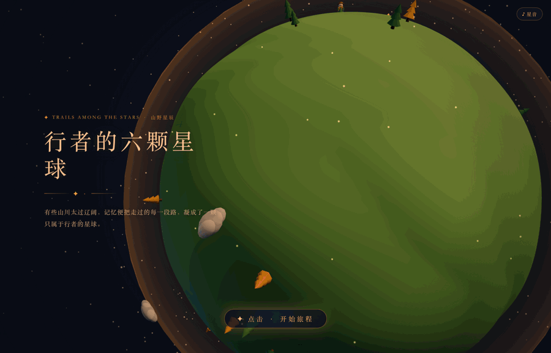
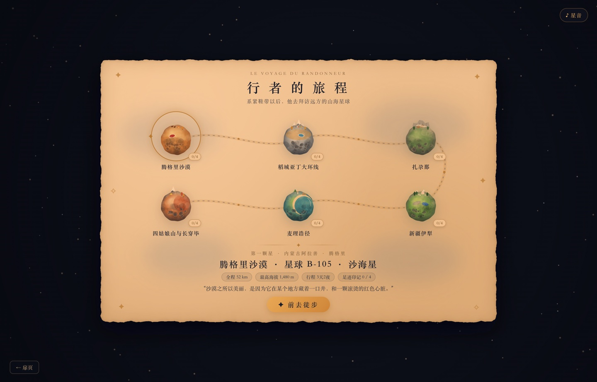
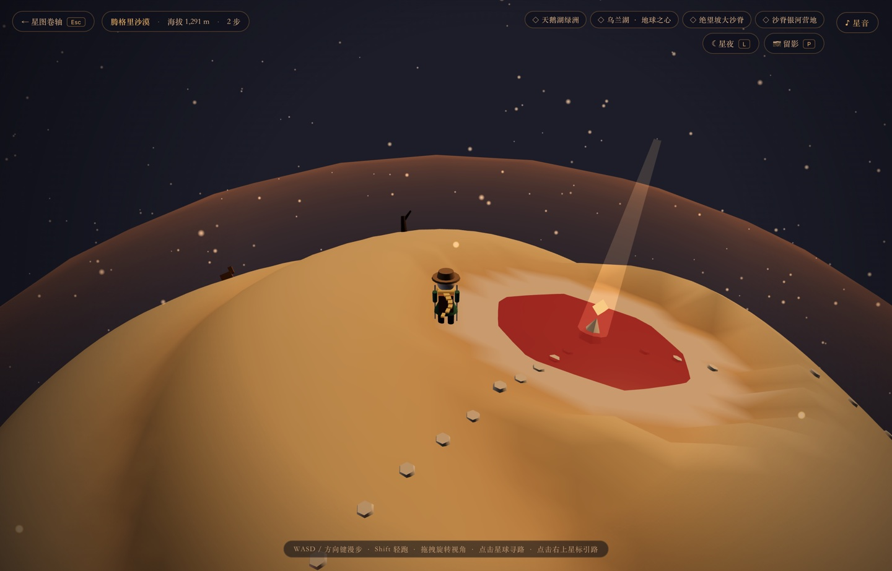
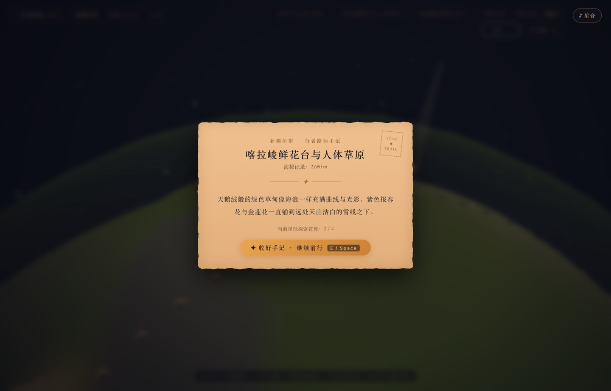

<div align="center">

# ✦ 山野星辰 · 行者的六颗星球 ✦
### *TRAILS AMONG THE STARS*

> *“有些山川太过辽阔，记忆便把走过的每一段路，凝成了一颗只属于行者的星球。”*

灵感源自《小王子：星辰之旅》(*The Little Prince Among the Stars*) 的 3D 绘本风徒步星球漫游游戏。  
基于 **Three.js + Web Audio API** 纯前端实现，零外部后端与外网资源依赖。

<br/>



<p><i>▲ 实机录制：星空扉页 → 手撕羊皮纸星图卷轴 → 3D 星球 360° 漫步与手记收集</i></p>

</div>

---

## 🌌 画面一览 · Gallery

### 第一幕 & 第二幕：星空扉页与羊皮纸星图卷轴

<table>
  <tr>
    <td width="50%" align="center">
      
      <br/>
      <b>星空扉页 · 起点星与篝火行者</b>
    </td>
    <td width="50%" align="center">
      
      <br/>
      <b>手撕毛边羊皮纸星图 · 六颗手绘水彩微缩星球</b>
    </td>
  </tr>
</table>

### 第三幕：3D 球面重力徒步与行者路标手记

<table>
  <tr>
    <td width="50%" align="center">
      
      <br/>
      <b>腾格里沙漠 · 金色新月沙梁与石板步道</b>
    </td>
    <td width="50%" align="center">
      
      <br/>
      <b>稻城亚丁大环线 · 雪峰云海与星光引路弧线</b>
    </td>
  </tr>
  <tr>
    <td width="50%" align="center">
      
      <br/>
      <b>麦理浩径 · 星夜模式下点亮户外头灯漫步山海</b>
    </td>
    <td width="50%" align="center">
      
      <br/>
      <b>新疆伊犁 · 收集发光玛尼堆路标与羊皮纸手记明信片</b>
    </td>
  </tr>
</table>

---

## 🪐 初版收录的六颗徒步星球

| 星球代号 | 路线名称 | 行程概览 | 里程与爬升 | 最高海拔 | 特色 3D 地貌与故事微缩景观 |
| :--- | :--- | :--- | :---: | :---: | :--- |
| **B-105 · 失联沙海星** | **腾格里沙漠** | 三天两晚 | 深入沙海腹地 | `1,480 m` | 新月形沙丘、紫色马兰花绿洲、篝火荧光棒、神树与沙漠绿邮筒 |
| **B-4900 · 三神山转山星** | **稻城亚丁大环线** | 六天五晚 | `70 km` (爬升4000m) | `4,900 m` | 三神山雪峰、松多垭口经幡、驮可乐箱的马帮、暴雪营地与弯曲杖杆 |
| **B-3970 · 十一垭口星** | **扎尕那** | 四天四夜 | `55 km` (11座垭口) | `4,320 m` | 多洛米蒂落日石峰、小木屋营地、红军垭口探路无人机与高青客繁星密林 |
| **B-5025 · 四年执念星** | **四姑娘山与长穿毕** | 四年圆梦 · 三天两夜 | 大峰13km+ / 长穿毕38km | `5,025 m` | 山巅红字「5025m 大峰石碑」、大本营铜锅火锅、木骡子红石滩与 4661m 垭口 |
| **B-100 · 龙年收官山海星** | **麦理浩径** | 生日山海露营 | 最美海岸精华线 | 破边洲海崖 | 咸田湾海面孤岛与绯红海上日出光球、破边洲六角火山岩柱群与标距柱 |
| **B-2073 · 月亮收集者星** | **新疆伊犁** | 中秋旷野巡游 | 环湖爬升 & 旷野 | `0–3,200 m` | 赛里木湖与果子沟大桥、唐布拉对称雪原羊群、大海道雅丹与皎洁大圆月🌕 |

---

## ✨ v2.0 版本特性

- **定制行者角色**：复刻沙漠徒步穿搭（深灰宽檐渔夫帽、亮橙镀膜风镜、酒红冲锋衣、随步伐轻晃的双小辫，以及外挂银灰蛋巢防潮垫、毛球与平安小红牌的 60L 重装包）。
- **拍立得照片明信片**：每个路标打卡点配有复古拍立得相纸明信片（实拍旅途大片 + 定制绘本插画），点击相框可全屏放大预览。
- **七首专属治愈轻音乐 BGM**：基于 Web Audio 空间延迟混响合成器，为扉页/星图及六颗星球分别谱写不同调式与泛音质感的纯音乐旋律及风浪环境声。
- **全平台自适应交互**：完美适配桌面键鼠与手机竖屏触控（移动端单指环视、点地寻路、无多余按键干扰）。

---

## 🎮 操作指南

- **球面漫步**：`W` `A` `S` `D` 或 `方向键` 360° 环绕星球行走，按住 `Shift` 轻快小跑
- **点击寻路（支持手机触屏）**：直接点击/轻触星球任意地面，小行者会自动沿球面走过去
- **环视与缩放**：按住鼠标左键（或单指）拖动旋转视角，滚轮调整远近
- **星光引路**：点击右上角任意一个路标名称胶囊，星球上空会亮起一道**金色引路光弧**
- **路标手记**：靠近发光玛尼堆路标时按 `E`（或点击底部金色按钮）展开羊皮纸手记明信片
- **氛围与留影**：
  - `L`：切换 **晨曦天光 / 星夜极光模式**（夜晚小行者会自动点亮户外头灯）
  - `P`：开启/退出 **纯净明信片留影模式**（隐藏全部 UI）
  - `M`：开启/静音 **Web Audio 程序化星辰八音盒与自然风声**
  - `Esc`：返回羊皮纸星图卷轴切换其他星球

---

## 🚀 本地运行与部署

项目为 **100% 纯静态网页**（已内置 `vendor/three.module.js`，无需打包构建）：

```bash
git clone https://github.com/Liaoqing-up/hiking-planets.git
cd hiking-planets

# 启动本地及局域网服务（浏览器访问 http://127.0.0.1:8765）
npm start

# （可选）通过 Cloudflare Tunnel 生成临时公网 HTTPS 试玩链接
npm run tunnel
```

### 开启永久免费在线游玩（GitHub Pages）
在本仓库页面进入 **`Settings` → `Pages`**，将 **Build and deployment → Branch** 设为 `main` (`/ (root)`) 并点击 **Save**，约 1 分钟后即可通过以下永久网址在任何手机或电脑上直接体验：

👉 **`https://liaoqing-up.github.io/hiking-planets/`**

---

## 📂 目录结构

```text
hiking-planets/
├── index.html              # 三幕式界面结构（扉页 / 羊皮纸星图卷轴 / 3D 探索界面与手记弹窗）
├── styles.css              # 绘本夜空、SVG 手撕羊皮纸毛边滤镜、桌面与移动端响应式样式
├── assets/                 # 实机录制 GIF 动图与高清场景截图
├── js/
│   ├── data.js             # 6 条徒步路线的海拔、里程、配色及 24 处真实路标诗意手记
│   ├── planetArt2D.js      # 星图卷轴上的 6 颗手绘水彩微缩星球插画渲染器
│   ├── planetBuilder3D.js  # Three.js 3D 球面高度场、湖海云朵、专属生态地标与金色围巾小行者模型
│   ├── audio.js            # 纯 Web Audio API 合成的自然风声、脚步声与星辰音乐盒音效
│   └── main.js             # 三幕转场、无死锁球面四元数行走控制器、引路星弧与本地存档逻辑
└── vendor/                 # 内置 Three.js 本地模块（离线零外网依赖）
```
